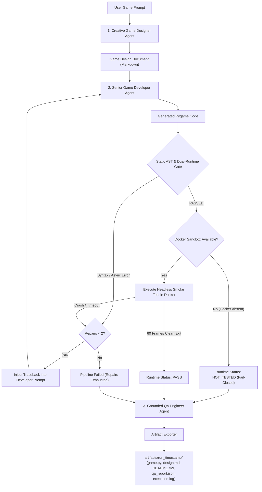

# Agentic Game Studio
### Multi-Agent Game Generation with Deterministic Static Validation, Isolated Sandboxing, and Closed-Loop Self-Repair

[](https://www.python.org/)
[](https://www.crewai.com/)
[](https://ai.google.dev/)
[](https://www.pygame.org/)
[](https://www.docker.com/)
[](https://docs.pytest.org/)

---

## 1. Overview & Problem Statement

Standard generative AI approaches to code generation suffer from a fundamental failure mode: **open-loop hallucination**. When prompted to generate game code, Large Language Models frequently:
1. Emit unexecutable syntax or broken indentation.
2. Produce non-functional main loops that crash WebAssembly runtime environments (such as Pygbag) by omitting required async yields (`await asyncio.sleep(0)`).
3. Depend on ungrounded QA agents that review generated source text purely through LLM prompts, hallucinating that code "works perfectly" without ever compiling or executing it.
4. Pose security hazards by proposing arbitrary host-level script execution without containerized isolation.

**Agentic Game Studio** replaces ungrounded generation with a **closed-loop multi-agent engineering pipeline**. It couples Google Gemini 2.5 Flash and CrewAI with:
- **Deterministic Static AST Validation** (`ast.parse`, structural checks, security blacklist).
- **Hard-Capped Self-Repair Controller** (strictly limited to a maximum of 2 repair cycles).
- **Isolated Sandbox Execution** (fail-closed Docker container with disabled networking, non-root user, and resource bounds).
- **Evidence-Grounded QA Auditing** (QA agent receives empirical compiler and container logs, not assumptions).

---

## 2. System Architecture



---

## 3. Multi-Agent Roles & Specialization

The studio configures three specialized CrewAI agents powered by Google Gemini 2.5 Flash:

| Agent | Role & Responsibility | Grounding Mechanism |
|---|---|---|
| **Creative Game Designer** | Expands raw concepts into structured 2D design specifications (gameplay loop, entities, controls, win/loss rules). | Bounded by feasible single-file 2D Pygame scope. |
| **Senior Game Developer** | Implements self-contained, standalone Python scripts conforming to dual-runtime WebAssembly standards and deterministic smoke-test hooks. | Enforced by AST static validation and runtime compiler error feedback during repairs. |
| **QA Engineer & Code Auditor** | Audits code against design requirements and compiles the final quality assurance report. | **Empirically Grounded**: Explicitly prompted with real AST compiler outputs, container isolation status, and return codes. Never permitted to guess execution success. |

---

## 4. Deterministic Self-Repair Loop & Retry Budget

Unlike naive retry prompts that ask an LLM to "fix whatever is wrong", Agentic Game Studio employs **traceback-injected self-repair**:

1. **Deterministic Static Gate**:
   - `sandbox/validator.py` parses the code with `ast.parse`.
   - Verifies the presence of `async def main():` and `await asyncio.sleep(0)` (essential for Pygbag / WebAssembly compatibility).
   - Verifies the headless smoke-test hook (`os.getenv("SMOKE_TEST") == "1"`).
   - Scans for prohibited modules and system calls (`subprocess`, `os.system`, socket bindings).
2. **Targeted Repair Prompting**:
   - If static or dynamic execution checks fail, the exact syntax error line, character offset, compiler message, or runtime stderr traceback is injected directly into `create_repair_task()`.
3. **Hardcoded Repair Limit**:
   - Governed by imperative Python logic in `StudioOrchestrator` (`while True` with an integer counter).
   - **Strict Maximum of 2 Repair Attempts**. The LLM cannot override or extend this limit.
   - If code fails after 2 repairs, the pipeline terminates cleanly with `pipeline_status: "FAILED"`.

---

## 5. Technology Stack

- **Language & Runtime**: Python 3.11+
- **Agent Framework**: CrewAI (`crewai>=0.100.0`)
- **LLM Provider**: Google Gemini (`gemini-2.5-flash` via `google-genai` / LiteLLM)
- **Game Engine**: Pygame (`pygame>=2.5.0`)
- **Isolation Sandbox**: Docker (`python:3.11-slim`, `--network none`, non-root user `1000:1000`)
- **Web Packaging (Optional)**: Pygbag (`pygbag>=0.9.0`)
- **Tunnel Sharing (Optional)**: Ngrok (`pyngrok>=7.0.0`)
- **Testing**: Pytest (`pytest>=8.0.0`)

---

## 6. Directory Structure

```text
agentic-game-studio/
├── .env.example             # Configuration template (keys, models, timeouts)
├── .gitignore               # Excludes secrets, .env, artifacts, caches, and logs
├── Dockerfile               # Sandboxed headless execution container definition
├── main.py                  # Production CLI entrypoint with input validation
├── pytest.ini               # Pytest configuration and path resolution
├── requirements.txt         # Production and development dependencies
├── config/
│   ├── __init__.py
│   └── settings.py          # Environment settings loader and credential masking
├── sandbox/
│   ├── __init__.py
│   ├── executor.py          # DockerExecutor (fail-closed) and MockExecutor
│   └── validator.py         # Deterministic AST syntax and safety validator
├── studio/
│   ├── __init__.py
│   ├── agents.py            # CrewAI agent definitions (Designer, Developer, QA)
│   ├── delivery.py          # Opt-in Pygbag web builder and Ngrok tunnel helper
│   ├── exporter.py          # Multi-file run artifact exporter
│   ├── orchestrator.py      # Self-repair controller (StudioOrchestrator)
│   └── tasks.py             # Evidence-grounded CrewAI task factories
└── tests/
    ├── conftest.py          # Shared test fixtures
    ├── test_cli_and_exporter.py    # CLI validation and artifact export tests
    ├── test_config.py              # Configuration and secret masking tests
    ├── test_delivery_and_sandbox.py # Dockerfile and delivery utility tests
    ├── test_executor.py            # Sandbox executor interface tests
    ├── test_orchestrator.py        # Self-repair loop and retry limit tests
    └── test_validator.py           # AST validation and security check tests
```

---

## 7. Installation & Configuration (Windows)

### Prerequisites
- Python 3.11 or higher installed and added to `PATH`.
- Git installed.

### Step 1: Clone and Set Up Virtual Environment
Open PowerShell in your working directory:

```powershell
# Navigate into project directory
cd agentic-game-studio

# Create virtual environment
python -m venv .venv

# Activate virtual environment
.venv\Scripts\Activate.ps1

# Upgrade pip and install dependencies
python -m pip install --upgrade pip
pip install -r requirements.txt
```

### Step 2: Configure Environment Variables
Copy `.env.example` to `.env`:

```powershell
Copy-Item .env.example .env
```

Open `.env` in an editor and populate your Google Gemini API key:
```env
# Required: Obtain at https://aistudio.google.com/app/apikey
GEMINI_API_KEY=your_actual_gemini_api_key_here
GEMINI_MODEL=gemini-2.5-flash

# Optional: Required only if using public tunnel sharing (--share)
NGROK_AUTHTOKEN=your_ngrok_authtoken_here

# Runtime constraints
MAX_REPAIR_ATTEMPTS=2
SMOKE_TEST_FRAMES=60
EXECUTION_TIMEOUT_SECONDS=10
```

---

## 8. CLI Usage Examples

### 1. Basic Generation Run
```powershell
python main.py "Create a retro endless neon runner"
```

### 2. Custom Output Directory and Repair Budget
```powershell
python main.py "Classic breakout brick-breaker game" --artifacts-dir ./my_runs --max-repairs 1
```

### 3. Optional Pygbag Web Packaging (`--web`)
```powershell
python main.py "Space dodge asteroid field" --web
```
*(Requires `pygbag` installed. If absent, cleanly reports `NOT_INSTALLED` without crashing).*

### 4. Optional Public Tunnel Sharing (`--share`)
```powershell
python main.py "Space dodge asteroid field" --web --share
```
*(Requires `NGROK_AUTHTOKEN` configured in `.env`. Credentials are never logged).*

### 5. Help and Flags Reference
```powershell
python main.py --help
```

---

## 9. Output Artifacts

Each execution automatically exports a dedicated directory inside `artifacts/`:

```text
artifacts/
└── run_20261012_210515_create_a_neonthemed/
    ├── game.py            # Complete standalone Python game code
    ├── design.md          # Full 2D Game Design Document
    ├── README.md          # Play instructions, controls, and empirical status
    ├── qa_report.json     # Machine-readable AST metrics, repair history, and QA report
    └── execution.log      # Compiler diagnostics, traceback records, and notes
```

### Decoupled Status Reporting (`qa_report.json`)
The studio explicitly separates workflow completion from runtime verification:

```json
{
  "run_id": "run_20261012_210515_create_a_neonthemed",
  "prompt": "Create a neon-themed endless runner",
  "timestamp": "2026-10-12T21:05:15.123456",
  "pipeline_status": "COMPLETED",
  "static_validation_status": "PASSED",
  "artifact_export_status": "SUCCESS",
  "runtime_execution_status": "NOT_TESTED",
  "game_verified": false,
  "repair_attempts": 0,
  "max_repair_attempts": 2,
  "static_validation": {
    "is_valid": true,
    "syntax_valid": true,
    "has_dual_runtime": true,
    "has_smoke_test_hook": true,
    "errors": []
  },
  "runtime_execution": {
    "status": "NOT_TESTED",
    "isolation_backend": "none",
    "notes": "Docker is not available on this host. Arbitrary AI-generated code was NOT executed directly on the host machine to preserve system security. Reported as NOT_TESTED."
  }
}
```

> **Integrity Note**: `game_verified` is strictly `false` whenever execution is `NOT_TESTED`. The studio never claims a game is verified when only static AST checks have passed.

---

## 10. Security Architecture & Docker Sandbox

### Fail-Closed Host Safety Policy
Untrusted AI-generated code is **never** executed directly on the host machine. If Docker is unavailable or unconfigured, the runtime check is safely bypassed and marked as `NOT_TESTED`.

### Docker Sandbox Constraints
When Docker is available, execution occurs inside the image defined in [`Dockerfile`](./Dockerfile):

```bash
docker run --rm \
  --network none \
  --user 1000:1000 \
  --memory 512m \
  --cpus 1.0 \
  --env SDL_VIDEODRIVER=dummy \
  --env SDL_AUDIODRIVER=dummy \
  --env SMOKE_TEST=1 \
  --env SMOKE_TEST_FRAMES=60 \
  -v /path/to/game.py:/workspace/game.py:ro \
  agentic-game-sandbox:latest \
  python /workspace/game.py
```

- **Network Isolation**: `--network none` prohibits all inbound and outbound network access.
- **Unprivileged Execution**: `--user 1000:1000` prevents root privilege escalation.
- **Resource Limits**: Strict 512MB RAM and 1.0 CPU allocation prevent denial-of-service loops.
- **Read-Only Mounting**: Source code is mounted read-only (`:ro`); container cannot modify host files.
- **Zero Credential Exposure**: No environment files or API keys are passed to the container.

---

## 11. Testing & Verification

The test suite contains **49 automated offline tests** executing across 6 test modules:

```powershell
pytest -v
```

### Test Coverage Breakdown
- **Configuration & Security (`test_config.py`)**: 3 tests verifying default values, environment overrides, and secret masking.
- **Static Validation (`test_validator.py`)**: 5 tests verifying AST parsing, dual-runtime checks, smoke-test detection, and prohibited module blacklisting.
- **Executor Interface (`test_executor.py`)**: 3 tests verifying fail-closed Docker absence behavior and mock execution.
- **Self-Repair Controller (`test_orchestrator.py`)**: 13 tests verifying successful orchestration, static error repair, runtime failure repair, timeout repair, retry limit cap enforcement (max 2), missing API keys, and QA status grounding.
- **CLI & Artifacts (`test_cli_and_exporter.py`)**: 14 tests verifying argument validation, `--max-repairs` bounds, atomic directory exports, failed run tolerance, and JSON serialization.
- **Delivery & Sandboxing (`test_delivery_and_sandbox.py`)**: 11 tests verifying Dockerfile constraints, container CLI flags, timeout handling, Pygbag checks, and Ngrok token protection.

---

## 12. Verification Status & Known Limitations

To maintain strict engineering transparency, capabilities are categorized by verification level:

### Verified via Automated Tests
- [x] Deterministic static AST parsing and syntax failure detection.
- [x] Dual-runtime async loop requirement and smoke-test hook validation.
- [x] Hardcoded 2-attempt self-repair controller logic.
- [x] Error traceback injection into Developer agent repair prompt.
- [x] Multi-file atomic artifact export and schema serialization.
- [x] Fail-closed Docker absence detection (`status="NOT_TESTED"`).
- [x] CLI argument validation and bounds checking (`--max-repairs` in `[0, 2]`).
- [x] Secret masking and exclusion of credentials from logs and artifacts.

### Pending Live Verification (Offline Tests Used Mocks)
- [ ] **Live Google Gemini API Execution**: Unit tests use mocked task runners to prevent consuming user API credits. Live model generation requires a configured `GEMINI_API_KEY`.
- [ ] **Live Docker Sandbox Daemon**: The test machine did not have a running Docker daemon; container command construction was verified via unit tests with mock subprocess runners.
- [ ] **Live Pygbag Web Builds & Ngrok Tunnels**: Pygbag and ngrok were not installed globally on the test environment; CLI error handling, missing-package detection, and credential shielding were verified via unit tests.
